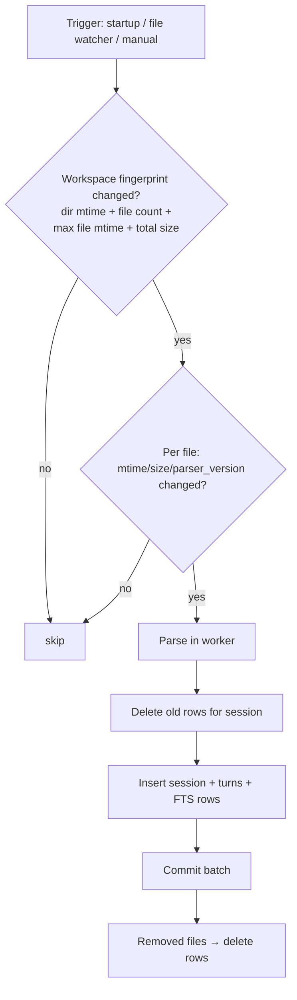
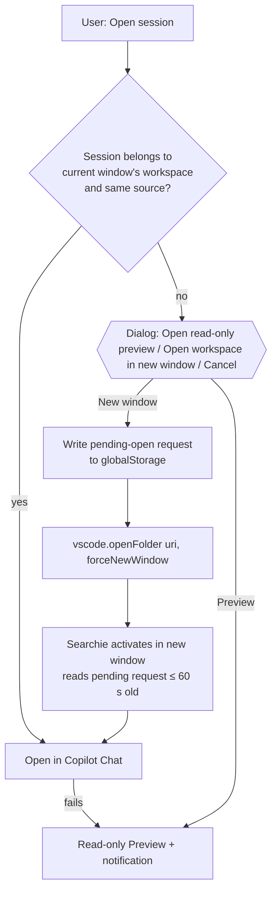
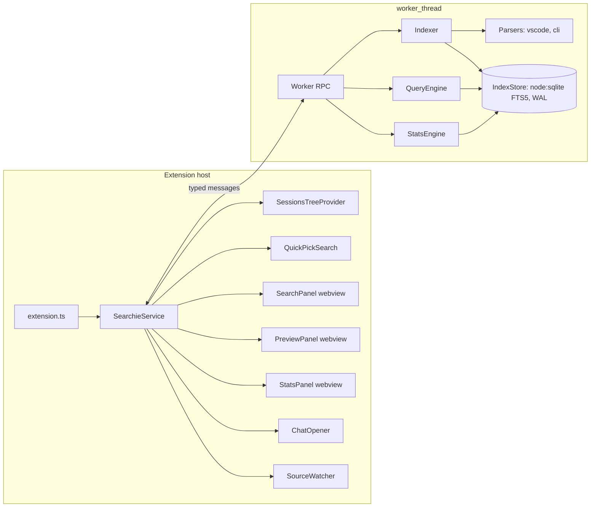

# Searchie – Specification

| | |
|---|---|
| Repository | `searchie` |
| Display name | **Searchie** |
| Type | VS Code extension |
| Status | Draft v0.4 – Phase 2 decisions: CLI source, folder grouping, fuzzy search, Search Panel, Statistics, CSV |
| Date | 2026-11-10 |

---

## 1. Overview

Searchie is a VS Code extension for **full-text search across GitHub Copilot chat sessions**, with a session browser, usage statistics and the ability to jump back into a found session.

Built-in Copilot chat history only searches by session title. Searchie indexes the full conversation content (prompts, responses, tool calls, referenced files) across all workspaces and all supported Copilot surfaces.

### 1.1 Goals

- G1 – Full-text, ranked search over all local Copilot sessions in < 100 ms.
- G2 – Session list grouped by workspace and time, with per-session statistics.
- G3 – Aggregate statistics (sessions, turns, prompts, models, modes, tools, activity, tokens/credits).
- G4 – Open a found session in Copilot Chat (same workspace) or via read-only preview / new window (other workspace).
- G5 – 100% local, read-only on source data, zero telemetry.

### 1.2 Non-goals (v1)

- Editing, deleting or exporting sessions back to VS Code storage.
- Semantic / embedding search and any ML model – out of scope permanently; Searchie is pure full-text search.
- Non-Copilot assistants (Claude, Cursor, Codex, …).
- Copilot integration (`@searchie`, LM tool) – planned for v2 (§15).

### 1.3 Glossary

| Term | Meaning |
|---|---|
| Source | A Copilot surface whose sessions are read (VS Code Stable, Insiders, Copilot CLI). |
| Session | One chat conversation (one `.jsonl` file or one CLI session directory). |
| Turn | One user request + the assistant response to it. Unit of indexing. |
| Prompt | A user-submitted message (a turn that is not hidden/system-generated). |
| Noise prompt | Trivial prompt like `continue`, `yes`, `try again` (see §5.4). |
| Workspace | The folder / `.code-workspace` a session belongs to, or *Empty window*. |

---

## 2. Relationship to Searchie prototype

Searchie is an independent repository. Proven concepts and code are **copied** (not shared as a package) from the Searchie prototype.

| Copied / adapted from Searchie prototype | Purpose in Searchie |
|---|---|
| `reconstructFromJsonl`, `setAtPath`, `appendAtPath`, `forEachJsonlLine(Async)` (`src/core/parser-vscode-files.ts`) | Streaming replay of `.jsonl` session logs with prototype-pollution guard |
| `stripImageData` | Drop embedded image byte arrays before `JSON.parse` |
| `workspaceLocationFromJson`, `findVsCodeDirs`, `session-roots.ts` | Source and workspace discovery (macOS / Linux / Windows, extra roots) |
| `parser-vscode-cli.ts` | Copilot CLI session parsing |
| `isNoise`, `normalizePrompt` (`analyzer-workflows.ts`) | Noise prompt detection |
| `redact-secrets.ts` | Secret redaction in snippets and preview |
| Worker pattern (`parse-worker.ts`, `parse-chunking.ts`) | Off-thread indexing with chunked IPC |
| Per-workspace fingerprint cache (`cache.ts`) | Fast change detection |
| Tooling: esbuild, Vitest, zod, Preact + htm, Chart.js | Same stack. The index engine is Searchie's own: built-in `node:sqlite` (§5.1), so there is no WASM asset to bundle |

Requirements:

- R2.1 – Copied files keep the original MIT copyright header (`Copyright (c) Microsoft Corporation`); the repository contains `THIRD_PARTY_NOTICES.md` listing the Searchie prototype origin with the full MIT license text, and the VSIX ships that file.
- R2.2 – Copied code lives under `src/core/vendor/` and carries a `// Adapted from Searchie prototype: <path>` line so origin stays traceable.
- R2.3 – Confirm internal approval to publish Searchie prototype-derived code publicly before Marketplace release (§14, Phase 3).

---

## 3. Session sources

### 3.1 Supported sources (v1)

| ID | Source | macOS default root | Format |
|---|---|---|---|
| `vscode` | VS Code Stable | `~/Library/Application Support/Code/User/` | `.jsonl` mutation log (and legacy `.json`) |
| `vscode-insiders` | VS Code Insiders | `~/Library/Application Support/Code - Insiders/User/` | same |
| `copilot-cli` | Copilot CLI | `~/.copilot/session-state/<sessionId>/` (Windows: `%USERPROFILE%\.copilot\…`) | `events.jsonl` + `workspace.yaml` |

Linux / Windows equivalents follow Searchie prototype `findVsCodeDirs` (`~/.config/Code/User`, `%APPDATA%\Code\User`, …).

### 3.2 File locations inside a VS Code root

| Path | Content |
|---|---|
| `workspaceStorage/<hash>/chatSessions/<sessionId>.jsonl` | Workspace sessions |
| `workspaceStorage/<hash>/chatSessions/<sessionId>.json` | Legacy full-JSON sessions |
| `workspaceStorage/<hash>/workspace.json` | `{ "folder": uri }` or `{ "workspace": uri }` → workspace identity |
| `globalStorage/emptyWindowChatSessions/*.jsonl` | Empty-window sessions (workspace = *Empty window*) |

### 3.3 Requirements

- R3.1 – Each source can be enabled/disabled in settings; missing roots are silently skipped.
- R3.2 – Additional roots (WSL, dev containers, remote homes) configurable via `searchie.additionalSessionRoots`. An entry is a **Copilot CLI root** when its basename is `session-state` or `history-session-state`, or when it is a `.copilot` directory (then its `session-state/` and `history-session-state/` are used). Otherwise it is a VS Code `User/` directory (it contains `workspaceStorage/` and/or `globalStorage/`); its source is `vscode-insiders` when the path contains `insiders` (case-insensitive), else `vscode`.
- R3.6 – Default CLI roots: `~/.copilot/session-state/` and, if present, the legacy `~/.copilot/history-session-state/`. A session directory is indexed when it contains `events.jsonl`; lock-only directories are skipped. A session id found in both roots is deduplicated like R5.19 (newest `events.jsonl` mtime wins).
- R3.3 – Workspaces can be excluded via `searchie.excludeWorkspaces` (glob on folder path). This applies to CLI sessions through their folder (`git_root` → `cwd`).
- R3.4 – Source files are opened **read-only**. Searchie never writes to any source directory.
- R3.5 – Files locked or being written (CLI `inuse.*.lock`) are read anyway; a parse failure is retried on next change, not reported as fatal.

---

## 4. Parsing and data model

### 4.1 VS Code `.jsonl` replay

Each line is one operation (verified on current VS Code builds):

| `kind` | Meaning | Fields |
|---|---|---|
| `0` | Initial snapshot | `v` = full session object |
| `1` | Set value at path | `k` = path array, `v` = value |
| `2` | Append to array at path | `k` = path array, `v` = items |

- R4.1 – Replay is streamed line-by-line (Searchie prototype `forEachJsonlLineAsync`, 1 MB chunks); a full file is never held as one string.
- R4.2 – `stripImageData` runs on each line before `JSON.parse`.
- R4.3 – Path segments `__proto__`, `constructor`, `prototype` are rejected; numeric segments are validated.
- R4.4 – Unknown `kind` values are ignored and counted in diagnostics.
- R4.5 – Legacy `.json` files are parsed as a single snapshot.
- R4.6 – The reconstructed object is validated with zod (lenient: unknown fields allowed, required fields: `sessionId`, `requests`).
- R4.7 – Parser has a `PARSER_VERSION` constant; bumping it forces re-index of all files.
- R4.13 – **Prune on replay** (required for N6, spike S2): right after each line's `JSON.parse`, fields that are never indexed or previewed are dropped before the entry is applied, so they never accumulate in memory. `toolInvocationSerialized` parts keep only `kind`, `toolId`, `toolCallId`, `invocationMessage`, `source`, `isComplete` and `toolSpecificData.commandLine`; `result.metadata` is dropped. For lines longer than 256 KB, the values of `resultDetails`, `toolSpecificData` and `metadata` are removed at string level before `JSON.parse` (the terminal command line is then lost for that call).
- R4.14 – Lines longer than 64 MB (R10.7) are skipped without being held in memory and counted as malformed.

### 4.2 Field mapping (VS Code)

Observed request fields: `requestId`, `timestamp`, `message`, `response[]`, `result`, `modelId`, `modeInfo`, `agent`, `promptTokens`, `completionTokens`, `copilotCredits`, `elapsedMs`, `contentReferences`, `variableData`, `hiddenFromTranscript`, `isSystemInitiated`, `modelState`. There is no `isCanceled` field (S2, VS Code 1.145.2; all sessions are `version: 3`).

| Model field | Source |
|---|---|
| `session.title` | `customTitle` → else first meaningful prompt (truncated 80 chars) |
| `session.createdAt` | `creationDate` |
| `turn.prompt` | `message.text` |
| `turn.response` | concatenated `response[]` parts with no `kind` (markdown `value`) + `inlineReference` names |
| `turn.thinking` | `response[kind=thinking].value` – a string **or an array of strings**; **not indexed by default** (setting; when on, appended to the hidden `aux` column) |
| `turn.toolCalls` | `response[kind=toolInvocationSerialized]` → tool id + invocation message, plus `toolSpecificData.commandLine` for terminal tools (no output) |
| `turn.files` | `contentReferences`, `variableData` variables of kind `file`, `codeblockUri`, `textEditGroup` URIs → file paths only |
| `turn.model` | `modelId` |
| `turn.mode` | `modeInfo` / `inputState.mode` (`agent`, `ask`, `edit`, custom agent file) |
| `turn.tokens` | `promptTokens`, `completionTokens` |
| `turn.credits` | `copilotCredits` |
| `turn.elapsedMs` | `elapsedMs` |
| `turn.hidden` | `hiddenFromTranscript` or `isSystemInitiated` |
| `turn.canceled` | `modelState.value === 2` |

- R4.8 – Attachment **content** (e.g. `result.metadata.renderedUserMessage`) is never indexed – only file names/paths.
- R4.9 – Tool **outputs** and terminal output are never indexed.
- R4.10 – Per-turn indexed text is capped (`searchie.index.maxTurnTextKB`, default 64 KB per field); overflow is truncated, not dropped.

### 4.3 Copilot CLI

- R4.11 – `events.jsonl` is mapped to the same model (own implementation of the S3 mapping); workspace from `workspace.yaml` (`git_root` → `cwd`, label `repository`), else from `session.start.data.context` (`gitRoot` → `cwd`), updated by `session.resume.data.context`.
- R4.15 – `workspace.yaml` is read with a minimal parser for flat top-level `key: value` pairs (plain, single-quoted and double-quoted scalars with YAML escapes); nested, multi-line and block values are ignored, and a field that can't be parsed falls back as in R4.11 / the title rule. No YAML dependency. The file is read only up to 64 KB.
- R4.16 – The CLI parser has its own `PARSER_VERSION`; tool calls named `report_intent` are skipped (meta, S3).
- R4.12 – ✅ Resolved by spike S3 ([spikes/S3-copilot-cli.md](spikes/S3-copilot-cli.md)), verified on CLI 1.0.95–1.0.103 and the public `github/copilot-sdk` session-events schema. Mapping:

A turn starts at a **root** `user.message`, i.e. one without a top-level `agentId`. All events up to the next root `user.message` belong to that turn. Events with `agentId` come from sub-agents: they never start a turn and never contribute response text.

| Model field | CLI source |
|---|---|
| `SessionMeta.id` | `session.start.data.sessionId` → else directory name |
| `workspaceId` / `workspaceUri` | `workspace.yaml` `git_root` → else `cwd` (`file://` URI); `workspaceName` = `repository` → else folder basename |
| `title` | `workspace.yaml` `name` → else first meaningful prompt |
| `createdAt` / `lastActivityAt` | `session.start.data.startTime` / last event `timestamp` (fallback `workspace.yaml` `created_at` / `updated_at`) |
| `Turn.timestamp` | root `user.message.timestamp` |
| `Turn.prompt` | `user.message.data.content` (not `transformedContent`) |
| `Turn.response` | concatenated `assistant.message.data.content` without `agentId` / `data.parentToolCallId` |
| `Turn.thinking` | `assistant.message.data.reasoningText` |
| `Turn.toolCalls` | `tool.execution_start.data.toolName` (+ `mcpServerName`) + compact `data.arguments` (`path`, `paths`, `command`, `pattern`, `query`, `url`, `skill`); never `tool.execution_complete.data.result` |
| `Turn.files` | `user.message.data.attachments[].path` / `.filePath`, `tool.execution_complete.data.fileEdits[].path`, `arguments.path` of `view`/`edit`/`create`/`grep`/`glob` |
| `Turn.model` | most frequent `assistant.message.data.model` in the turn → else current model (`session.start.data.selectedModel`, updated by `session.model_change.data.newModel`) |
| `Turn.mode` | `user.message.data.agentMode` (`interactive` \| `plan` \| `autopilot` \| `shell`) → else last `session.mode_changed.data.newMode` → `interactive` |
| `Turn.promptTokens` / `completionTokens` | Σ `session.usage_record.data.usage.inputTokens` / `outputTokens` within the turn |
| `Turn.credits` | Σ `usage.copilotUsage.totalNanoAiu` / 1e9 within the turn (only when `aiCreditsStatus = complete`) |
| `Turn.elapsedMs` | last root `assistant.turn_end.timestamp` − `user.message.timestamp` |
| `Turn.canceled` | `abort` event within the turn |
| `Turn.hidden` | `user.message.data.source` set (`skill-*`, `agent-*`) or `data.isAutopilotContinuation` |

Ignored event types: `hook.*`, `permission.*`, `external_tool.*`, `model.*`, `subagent.*`, `system.message`, `session.usage_checkpoint`, `session.shutdown`, `session.binary_asset` (base64 bytes), `assistant.turn_start`. `type` is always the first JSON key, so ignored lines are skipped before `JSON.parse`.

### 4.4 Normalized model

```ts
interface SessionMeta {
  id: string;                 // sessionId
  source: 'vscode' | 'vscode-insiders' | 'copilot-cli';
  workspaceId: string;        // '<source>:<storage hash>', '<source>:empty-window', or 'copilot-cli:<folder hash>' (R5.21)
  folder?: string;            // normalized folder key (R5.21); groups sessions of all sources by project
  workspaceName: string;
  workspaceUri?: string;      // folder or .code-workspace URI
  filePath: string;
  copies: { workspaceId: string; filePath: string }[];  // other copies of the same session (R5.19)
  title: string;
  createdAt: number;
  lastActivityAt: number;
  turnCount: number;
  promptCount: number;
  noisePromptCount: number;
  canceledCount: number;
  toolCallCount: number;
  models: Record<string, number>;   // modelId -> turns
  modes: Record<string, number>;
  tools: Record<string, number>;
  promptTokens?: number;
  completionTokens?: number;
  credits?: number;
  elapsedMs?: number;
  sizeBytes: number;
}

interface Turn {
  sessionId: string;
  index: number;
  timestamp: number;
  prompt: string;
  response: string;
  toolCalls: { tool: string; args: string }[];
  files: string[];
  model?: string;
  mode?: string;
  promptTokens?: number;
  completionTokens?: number;
  credits?: number;
  elapsedMs?: number;
  hidden: boolean;
  canceled: boolean;
  noise: boolean;
}
```

---

## 5. Indexing

### 5.1 Engine

**SQLite FTS5 via built-in `node:sqlite`** (file-backed, WAL), running in a Node `worker_thread` with `resourceLimits.maxOldGenerationSizeMb = 256`. Decided in spike S2 ([spikes/S2-index-engine.md](spikes/S2-index-engine.md)).

- R5.1 – ✅ Resolved by S2. Stock `sql.js` 1.15.2 has **no FTS5**, so the §5.3 schema fails. `node:sqlite` (VS Code 1.145.2: Node 24.22.1, SQLite 3.53.4; also verified in the extension host and a `worker_thread` by S1) supports the full §5.3 schema. Measured on Apple Silicon:

  | Target | Real data (510 MB source, 739 turns) | Synthetic 50 000 turns |
  |---|---|---|
  | N2 cold build ≤ 90 s / 500 MB | 1.1 s | insert 13.2 s |
  | N3 incremental < 1 s | 6 ms | 10 ms |
  | N4 search p95 < 100 ms (24 queries) | 5.9 ms | 44 ms |
  | N6 peak RSS < 600 MB | 373 MB | 361 MB |
  | N7 index ≤ 40 % of source | 2.7 % | 1.9 % (649 MB) |

  N6 depends on the 256 MB worker heap cap (without it 557–625 MB) and on **prune-on-replay**: tool payloads (`resultDetails`, `toolSpecificData`) and `result.metadata` are dropped right after each line's `JSON.parse`, or at string level for lines > 256 KB.
- R5.2 – Fallbacks, in order: `@sqlite.org/sqlite-wasm` (in-memory + export; it works but N6 fails at 50k turns with 4.3 GB RSS); `wa-sqlite` with a file-backed VFS. A custom FTS5 `sql.js` build is not recommended. The storage layer stays behind an `IndexStore` interface.
- R5.18 – Parsing and indexing run in the worker with `resourceLimits.maxOldGenerationSizeMb = 256` (required for N6, spike S2). If the worker dies with `ERR_WORKER_OUT_OF_MEMORY`, the file being parsed is marked `failed`, the worker is restarted, and indexing continues with the next file.

### 5.2 Storage

- Index DB file: `<globalStorageUri>/index.sqlite` (per VS Code installation; shared by all windows), WAL journal mode.
- R5.3 – Only one window writes the index at a time: a lock file `<globalStorageUri>/index.lock` (PID + heartbeat every 10 s, stale after 30 s). Other windows open the same file with `readOnly: true` and see committed data through WAL, so no reload is needed; they refresh their views when `PRAGMA data_version` changes and take over the lock when it becomes stale.
- R5.4 – Persistence: each indexing batch is one WAL transaction, durable on commit (no export, no debounce). A cold build or rebuild writes `<globalStorageUri>/index.sqlite.build` (rollback journal, no WAL) while the old index stays usable, then publishes it into `index.sqlite` in one step with SQLite's online backup API (`node:sqlite` `backup()`), which readers see atomically, and deletes the build file. The build file is not renamed over `index.sqlite`, because renaming over a database that other windows have open (with live `-wal`/`-shm` files) can corrupt it, and fails on Windows.
- R5.5 – File permissions `0600`.

### 5.3 Schema

```sql
CREATE TABLE meta      (key TEXT PRIMARY KEY, value TEXT);  -- schemaVersion, parserVersion, indexConfig, noisePatterns
CREATE TABLE workspaces(id TEXT PRIMARY KEY, source TEXT, name TEXT, uri TEXT,
                        fingerprint TEXT,                              -- §5.5
                        folder TEXT);                                  -- R5.21 folder key, NULL for empty window
CREATE TABLE files     (path TEXT PRIMARY KEY, source TEXT, workspace_id TEXT,
                        mtime INTEGER, size INTEGER, parser_version INTEGER,
                        session_key TEXT, status TEXT, error TEXT);  -- status: ok | empty | duplicate | failed
CREATE TABLE sessions  (key TEXT PRIMARY KEY,                        -- '<source>:<sessionId>' (R5.19)
                        id TEXT, file_path TEXT, source TEXT, workspace_id TEXT,
                        title TEXT, custom_title INTEGER, created_at INTEGER, last_at INTEGER,
                        turn_count INTEGER, prompt_count INTEGER, noise_count INTEGER,
                        canceled_count INTEGER, tool_call_count INTEGER,
                        prompt_tokens INTEGER, completion_tokens INTEGER,
                        credits REAL, elapsed_ms INTEGER, size_bytes INTEGER,
                        primary_model TEXT, primary_mode TEXT);
CREATE TABLE turns     (id INTEGER PRIMARY KEY, session_key TEXT, idx INTEGER, ts INTEGER,
                        model TEXT, mode TEXT, prompt_tokens INTEGER, completion_tokens INTEGER,
                        credits REAL, elapsed_ms INTEGER, hidden INTEGER, canceled INTEGER, noise INTEGER);
CREATE TABLE turn_tools(turn_id INTEGER, tool TEXT, count INTEGER);
CREATE TABLE turn_text (id INTEGER PRIMARY KEY, title TEXT, prompt TEXT, response TEXT,
                        tools TEXT, files TEXT, aux TEXT);           -- FTS content table
CREATE VIRTUAL TABLE turn_fts USING fts5(
  title, prompt, response, tools, files, aux,
  content='turn_text', content_rowid='id',
  tokenize="unicode61 remove_diacritics 2 tokenchars '_'",
  prefix='2 3'
);
CREATE VIRTUAL TABLE turn_vocab USING fts5vocab(turn_fts, 'row');    -- for fuzzy / suggestions
CREATE INDEX ix_sessions_ws  ON sessions(workspace_id, last_at);
CREATE INDEX ix_turns_session ON turns(session_key, idx);
CREATE INDEX ix_turn_tools   ON turn_tools(turn_id);
CREATE INDEX ix_files_session ON files(session_key);
CREATE INDEX ix_files_ws     ON files(workspace_id);
CREATE INDEX ix_workspaces_folder ON workspaces(folder);
```

Workspace ids are `<source>:<storage hash>`, `<source>:empty-window` or `copilot-cli:<folder hash>`, so sources never collide; `workspaces.folder` groups them by project (R5.21). The schema version is bumped to 2 (automatic rebuild, R5.17). The session title is stored in every turn's `title` column, so a query can combine a title term with a term from any turn.

### 5.4 Text processing

- R5.6 – Tokenizer `unicode61` with `remove_diacritics 2` → `členů` matches `clenu`; case-insensitive.
- R5.7 – Identifier splitting: for every token matching `[A-Za-z][A-Za-z0-9]*([A-Z_][a-z0-9]+)+` (camelCase, PascalCase, snake_case) the split parts are appended to the hidden `aux` column (`parseJsonLine` → `parse json line`). `aux` is never shown in snippets.
- R5.8 – File paths in `files`: full path + basename + basename without extension (so `parser-vscode.ts`, `parser-vscode`, `parser`, `vscode` all match).
- R5.9 – Tool calls in `tools`: tool name + compact args (paths, queries, commands, terminal command line), max 2 KB per call.
- R5.9a – Thinking text is indexed only when `searchie.index.includeThinking` is on; it is then appended to the hidden `aux` column (searchable, never shown in snippets).
- R5.10 – Noise prompts (adapted from Searchie prototype `isNoise`) are indexed with `noise = 1` and penalized in ranking (§6.3); they never become session titles. A prompt is noise when its trimmed text matches any of:
  - continue / retry / confirm phrases, optionally prefixed by `@agent`: `continue`, `try again`, `retry`, `stop`, `cancel`, `abort`;
  - `y`, `n`, `yes`, `no`;
  - contains `continue to iterate` and is < 80 chars;
  - ≤ 3 chars consisting only of `yYnN.!?`;
  - starts with `system`;
  - any user pattern from `searchie.noisePatterns` (case-insensitive regex, matched against the whole trimmed prompt, e.g. `pokračuj`).
  
  Unlike Searchie prototype, long prompts (> 2000 chars) are **not** noise.
- R5.11 – No stemming in v1 (multi-language content incl. Czech). Prefix queries (`refactor*`) cover most morphology needs.
- R5.12 – Secrets are **not** removed from the index (they must remain searchable by the owner) but are redacted on display (§10).

### 5.5 Incremental update



- R5.20 – The workspace fingerprint includes the max file mtime and total size, because VS Code appends to the `.jsonl` of an active session, which changes neither the directory mtime nor the file count. It costs one `stat` per file and lets an unchanged workspace skip all per-file comparisons.
- R5.21 – **Folder key** (Q3). Every workspace with a known folder gets `folder` = a normalized key: VS Code `workspace.json` `folder` URI (a `.code-workspace` URI keys the workspace file itself, so it is not merged), CLI `git_root` → `cwd`. Normalization: `file:` URIs become paths; separators become `/`; trailing `/` is removed; Windows-style paths (drive letter or UNC) are lower-cased as a whole; POSIX paths keep their case; non-`file` URIs keep `scheme://authority/path` with scheme and authority lower-cased. The CLI workspace id is `copilot-cli:` + the first 16 hex digits of SHA-256(folder key) (no path in ids or logs). Sessions without a folder (empty window, CLI without workspace info) are not merged.
- R5.22 – **CLI change detection.** The file unit of a CLI session is its `events.jsonl`; its recorded mtime and size combine `events.jsonl` and `workspace.yaml` (max mtime, sum of sizes), so a renamed session (`name`) or a resumed session in another folder is re-indexed. Discovery reads `workspace.yaml` of each session directory to group sessions by folder (cached by mtime in the worker); the CLI workspace fingerprint follows R5.20 over its sessions. A session whose folder changed moves to the new workspace. The watcher pattern on each CLI root is `*/{events.jsonl,workspace.yaml}`; R5.15 throttling applies. `inuse.*.lock` does not affect indexing (R3.5); it only matters for opening (R8.5).
- R5.13 – Startup: index opens immediately (UI usable with stale data), then a background scan runs.
- R5.14 – File watching: `vscode.workspace.createFileSystemWatcher` with `RelativePattern` on each source root (`workspaceStorage/*/chatSessions/*.{jsonl,json}`, `globalStorage/emptyWindowChatSessions/*.{jsonl,json}`, CLI `*/{events.jsonl,workspace.yaml}`), debounced 2 s. Fallback poll every 5 min (`searchie.index.pollIntervalMinutes`).
- R5.15 – Active session being written is re-indexed at most once per 10 s.
- R5.16 – Batches of ≤ 250 sessions per transaction; progress reported to status bar (`$(sync~spin) Searchie: indexing 120/840`).
- R5.17 – Command `Searchie: Rebuild Index` drops and rebuilds everything. A schema or parser version mismatch, or a change of `searchie.index.includeThinking` / `searchie.index.maxTurnTextKB` (stored as `indexConfig` in `meta`), triggers it automatically. A change of `searchie.noisePatterns` only re-flags `turns.noise` from the stored prompts and recomputes non-custom titles and session counts.
- R5.19 – **Duplicate session ids.** The same `sessionId` can exist as byte-identical copies in several `workspaceStorage` folders (spike S2: 24 ids × 2 extra copies, e.g. after a folder was reopened as a `.code-workspace`). Sessions are deduplicated by `(source, sessionId)`: the copy with the newest mtime is indexed (ties: the lexicographically first path), the others are kept in `files` with `status = 'duplicate'` and the same `session_key`. The session is listed under the winning copy's workspace; its tooltip names the other workspaces, and a window whose workspace holds any copy counts as the session's own workspace for §8. When the winning file is removed, the next copy is promoted.

---

## 6. Search

### 6.1 Query syntax

| Syntax | Meaning | Example |
|---|---|---|
| `word word` | All terms (AND) | `sql fts5` |
| `"…"` | Phrase | `"open session"` |
| `a OR b` | Either | `jest OR vitest` |
| `-word` | Exclude | `deploy -azure` |
| `word*` | Prefix | `refact*` |
| `~word` | Fuzzy (edit distance ≤ 2) | `~reconstuct` |
| `ws:` | Workspace name contains | `ws:searchie` |
| `src:` | Source | `src:cli` |
| `model:` | Model id contains | `model:opus` |
| `mode:` | Mode / custom agent | `mode:agent` |
| `tool:` | Tool used in turn | `tool:run_in_terminal` |
| `file:` | Referenced file contains | `file:parser` |
| `in:` | Restrict to column(s) | `in:prompt`, `in:response,tools` |
| `after:` / `before:` | Date (`YYYY-MM-DD`, `7d`, `3m`) | `after:30d` |

- R6.1 – Queries are parsed into an AST by a hand-written parser; the FTS5 `MATCH` expression is **generated** from the AST with every term quoted. Raw user input is never concatenated into SQL; all values are bound parameters.
- R6.2 – Invalid syntax degrades gracefully: unparseable parts are treated as plain terms.
- R6.3 – Filters (`ws:`, `model:`, …) become SQL `WHERE` clauses on `sessions` / `turns`, not FTS terms.
- R6.4 – Empty text query with filters only = filtered session list ordered by `last_at`.

### 6.2 Fuzzy and suggestions

- R6.5 – `~term`: the term is folded like the tokenizer (lower case, diacritics removed); terms shorter than 3 characters are not expanded. Candidates come from `turn_vocab` with a first-letter **range constraint** (`term >= ? AND term < ?`, which fts5vocab evaluates without a full scan: 6.8 ms at 50 000 turns / 116 000 distinct terms vs 172 ms for a full scan, measured in P0), length ±2, filtered by Damerau-Levenshtein ≤ 2 (≤ 1 for terms < 5 chars), ranked by distance then document frequency; the term itself plus at most 10 expansions are OR-ed as quoted terms in the AST (R6.1). No materialized vocabulary table; the worker caches candidates per first letter until the index changes (`data_version` for commits of other connections, `total_changes()` for the writer's own connection).
- R6.6 – If a query returns 0 results, a "Did you mean …" suggestion is computed for each positive plain term that has no document (`term = ?` lookup): the best candidate per R6.5. The suggestion is the query text with those terms replaced, offered only if it returns results. Quick Pick shows it as the first item; the Search Panel shows it above the results.
- R6.7 – Setting `searchie.search.autoFuzzy` (default `false`): when a query returns fewer than 3 sessions, it is re-run with every plain positive term expanded (phrases and prefixes unchanged), and the UI marks the results as fuzzy.
- R6.14 – N4 is measured with fuzzy queries included: the bench adds `~term` queries and misspelled terms (one deleted and one transposed letter of vocabulary terms at several frequency percentiles).

### 6.3 Ranking

Turn score:

$$
s_{turn} = -\mathrm{bm25}(w_{title}{=}5,\ w_{prompt}{=}4,\ w_{files}{=}2,\ w_{tools}{=}1.5,\ w_{response}{=}1,\ w_{aux}{=}0.5)\cdot r \cdot n
$$

- Recency boost $r = 1 + \beta \cdot e^{-age_{days}/90}$, $\beta$ = `searchie.search.recencyBoost` (default 0.2).
- Noise penalty $n = 0.2$ for noise prompts, else $1$.

Session score (results are grouped by session):

$$
s_{session} = \max_i s_{turn,i} + 0.25 \cdot \ln(k)
$$

where $k$ = number of matching turns in the session.

- R6.8 – Weights are constants in one module, tunable via hidden settings for experimentation.
- R6.9 – Default result limit 50 sessions (top 3 matching turns each); "Load more" pages by 50.

### 6.4 Snippets

- R6.10 – Snippets via FTS5 `snippet()` on the best-matching column, 24 tokens, using control-char markers (`\u0001`, `\u0002`). The UI HTML-escapes the snippet first, then replaces markers with `<mark>` – no raw HTML from data ever reaches a webview.
- R6.11 – Snippet text passes through secret redaction before display.

### 6.5 Performance

- R6.12 – Quick Pick queries debounced 150 ms; in-flight queries cancelled when a newer one starts.
- R6.13 – Target p95 < 100 ms for top-50 on 50 000 turns (§11).

---

## 7. User interface

### 7.1 Activity Bar container "Searchie"

Contains two views:

**a) Sessions (TreeView)**

```
▾ Summary: 842 sessions · 6 210 prompts · 24 workspaces · 3.1k credits (30d)
▾ searchie (VS Code)                       12 sessions
   ▾ Today
      Searchie spec discussion   · 6 prompts · opus-5.5 · agent · 2h ago
   ▸ This week
▸ likvidace (VS Code)                           48 sessions
▸ Empty window                                   5 sessions
▸ foo (Copilot CLI)                               3 sessions
```

- R7.1 – Grouping toggle: *Workspace → Date* (default), *Date → Workspace*, *Flat*.
- R7.2 – Sort: last activity (default), created, prompts, credits.
- R7.3 – Session item description: prompt count · primary model · mode · relative time. Tooltip (Markdown): title, workspace, source, created / last, turns, prompts, noise prompts, tool calls, top tools, tokens in/out, credits, duration, file size.
- R7.4 – Current workspace group expanded and pinned first. The current workspace is `<current source>:<basename(dirname(context.storageUri))>`, or `<current source>:empty-window` in an empty window; the current source is `vscode-insiders` when `vscode.env.appName` contains `Insiders`, else `vscode`. The current **group** is the folder group (R7.27) that contains the current workspace.
- R7.27 – Workspace groups are **folder groups** (R5.21): all workspaces with the same folder key form one group, whatever their source; workspaces without a folder form a group of their own. Label: the VS Code workspace name if present, else the CLI label (`repository` → folder basename), followed by the sources, e.g. `searchie (VS Code, Copilot CLI)`. *Search in this Workspace* scopes to all workspace ids of the group.
- R7.5 – Inline actions: *Open in Chat*, *Preview*. Context menu: *Open in Chat*, *Preview*, *Open Workspace in New Window*, *Copy Session ID*, *Reveal Session File*, *Search in this Session*, *Search in this Workspace*. The two *Search in this …* actions open Quick Pick with an internal scope (session key or workspace id), shown in the Quick Pick title and removable with a title button; they add no query syntax.
- R7.6 – View title actions: *Search*, *Open Search Panel*, *Statistics*, *Refresh*, *Filter* (source, model, mode, date range). *Filter* also offers *Group by* (R7.1) and *Sort by* (R7.2). Phase 1 ships *Search*, *Refresh* and *Filter*; *Open Search Panel* and *Statistics* come with Phase 2.

**b) Index status (welcome / footer)**

- R7.7 – Shown while indexing or on errors (count of failed files, link to output channel).

### 7.2 Quick Pick search (`Searchie: Search Sessions`)

- R7.8 – Live results while typing; each item = one session:
  - label: session title (with `$(comment-discussion)`; `$(terminal)` for CLI)
  - description: workspace · relative date · model
  - detail: best snippet (plain text, matched terms not highlightable in Quick Pick → shown in `«»`)
- R7.9 – `matchOnDescription/Detail = false` and `alwaysShow = true` (ranking comes from the index, not Quick Pick filtering). Known limit of the stable API: while text is typed, VS Code moves sessions whose *title* fuzzy-matches it to the top (label sorting can't be turned off without proposed API); the remaining order is the index ranking. Accepted, because titles carry the highest weight anyway.
- R7.10 – Item buttons: *Preview*, *Open Workspace in New Window*. Enter = *Open* (§8).
- R7.11 – A Quick Pick **title button** `$(link-external)` *Open in Search Panel* carries the current query and scope to §7.3. (A footer item would be re-sorted to the top whenever the typed text fuzzy-matches its label, R7.9.)
- R7.12 – Pre-fill: selected text in the active editor, else last query.

### 7.3 Search Panel (webview, Preact + htm)

Layout:

```
┌ Query: [ fts5 sql.js  ws:searchie after:30d          ] [Search] [?] ┐
│ Filters: Source [▾]  Workspace [▾]  Model [▾]  Mode [▾]  Date [▾]   │
│          In: ☑ prompt ☑ response ☑ tools ☑ files ☑ title            │
├──────────────────────────────────────────────────────────────────────┤
│ 37 sessions · 112 turns · 24 ms                     Sort: Relevance ▾│
│ ▸ Searchie spec discussion — searchie · 2h ago · opus-5.5        │
│     #3 You: …use **SQLite FTS5** via **sql.js**…                    │
│     #5 Copilot: …**FTS5** build must be confirmed…                   │
│     [Open in Chat] [Preview] [New Window]                            │
│ ▸ …                                                                  │
└──────────────────────────────────────────────────────────────────────┘
```

- R7.13 – Filter controls and query text stay in sync (editing a dropdown rewrites the `ws:` token and vice versa). Rules:
  - The query is split into tokens with their raw text (§6.1 tokenizer). Valid filter tokens drive the controls; everything else (terms, phrases, operators, invalid filters such as `after:yesterday`) is **text** and kept verbatim, in order.
  - Editing a control removes all tokens of that filter key and appends the new token(s) after the text, in the canonical order `src ws model mode tool file in after before`. Values containing whitespace are written as `key:"value"`; `"` inside values is dropped.
  - Date tokens keep their raw value (`after:30d` stays relative). The date control offers presets (7d, 30d, 90d, 1y) and absolute `YYYY-MM-DD`.
  - Typing in the query box re-derives the controls (debounced 150 ms). Round-trip guarantee: `parse(serialize(controls, text))` yields the same filters and the same text tokens.
- R7.14 – Clicking a turn opens Preview scrolled to that turn.
- R7.15 – Sort: relevance, newest, oldest, prompts, credits.
- R7.16 – Keyboard: `↑/↓` navigate, `Enter` open, `Space` preview, `Cmd/Ctrl+Enter` new window.
- R7.17 – Query history (last 20) stored in `globalState`.
- R7.18 – Syntax help popover (`?`).
- R7.19 – Webview: strict CSP with nonce, `localResourceRoots` limited to `dist/webview`, no remote resources, `retainContextWhenHidden = false` (state restored via `setState`).
- R7.20 – Communication via typed RPC messages (pattern from Searchie prototype `panel-rpc.ts`), validated with zod on both sides.

### 7.4 Session Preview (read-only)

- R7.21 – Webview editor tab titled `Searchie: <session title>`, rendering the conversation: user prompts, assistant markdown, collapsed thinking, tool calls as chips (name + args, no output), referenced files as links (opening the file if it exists locally).
- R7.22 – Header: workspace, source, dates, model(s), mode, tokens, credits, buttons *Open in Chat* (if possible, §8) and *Open Workspace in New Window*.
- R7.23 – In-preview find (`Cmd/Ctrl+F`) with search terms from the originating query pre-highlighted; scroll to target turn.
- R7.24 – Markdown rendered with a sanitizing renderer (`markdown-it` with `html: false`); code blocks highlighted locally.
- R7.25 – Secrets redacted (toggle *Show secrets* per preview, off by default).

### 7.5 Statistics view (webview)

See §9. Opened by `Searchie: Show Statistics`, the view-title action, or a click on the Summary node.

### 7.6 Status bar

- R7.26 – Item `$(search) Searchie` (click = search). While indexing shows progress; on errors shows `$(warning)`.

---

## 8. Opening sessions



- R8.1 – *Open in Chat* mechanism, confirmed by spike S1 ([spikes/S1-open-in-chat.md](spikes/S1-open-in-chat.md)) in VS Code 1.145.2. Calls don't throw on failure (an error editor is shown instead), so the session file must first be pre-checked in the current window's chat storage: `<dirname(context.storageUri)>/chatSessions/<id>.{jsonl,json}` in a folder/workspace window, or `<dirname(context.globalStorageUri)>/emptyWindowChatSessions/<id>.{jsonl,json}` in an empty window. Order:
  1. ✅ `vscode.open` on `vscode-chat-session://local/<base64url(sessionId), no padding>` (VS Code `LocalChatSessionUri.forSession`). Opens the session as a chat editor with full history. Available since VS Code 1.106.
  2. ✅ `workbench.action.chat.openSessionInEditorGroup` with argument `{ resource }`, if present in `getCommands(true)`.
  - Then, with `searchie.open.chatLocation = view` (default), `workbench.action.chat.openInSidebar` (*Move Chat into Side Bar*, feature-detected) loads the session into the **Chat view** and closes the temporary chat editor (VS Code `chatMoveActions.ts` → `IChatWidgetService.openSession(resource, ChatViewPaneTarget)`, which closes the editor for the move). This is the same path as clicking a session in VS Code's own sessions list, so the user continues the chat in the side bar. `editor` keeps the chat editor tab. Owner request after the Phase 1 manual test.
  3. Fallback: read-only Preview. Offer *Pick in Chat history* as a convenience: open the Chat view, run `workbench.action.chat.pickAgentSession` (`workbench.action.chat.history` no longer exists), and copy the title to the clipboard. In S1 the pasted title did not narrow the picker, so this is not a reliable fallback.
  - Copilot CLI sessions: `vscode.open` on `copilotcli:/<sessionId>` also opens them with history (S1); see R8.5.
- R8.2 – The mechanism is isolated in `ChatOpener` with feature detection (`vscode.commands.getCommands`) so it can change with VS Code releases without touching the rest.
- R8.3 – Other-workspace sessions always show the two-button choice (*Open read-only preview* / *Open workspace in new window*). Setting `searchie.open.otherWorkspaceDefault` = `ask` (default) | `preview` | `newWindow`.
- R8.4 – Empty-window sessions: *Open in new empty window* replaces *Open workspace*. In an empty window, empty-window sessions of the same source are same-workspace sessions (R8.1 pre-check in `emptyWindowChatSessions/`).
- R8.5 – CLI sessions (Phase 2): *Open in Chat* via `vscode.open` on `copilotcli:/<sessionId>` when the GitHub Copilot Chat extension (`github.copilot-chat`) is active and the session is not live; otherwise Preview. A session is **live** if its directory has an `inuse.<pid>.lock` whose process is alive (`process.kill(pid, 0)`); for sessions from additional roots (another machine) any `inuse.*.lock` counts as live. CLI sessions keep their own working directory, so they can be opened from any window (no other-workspace dialog); `searchie.open.chatLocation` applies if the move command accepts the CLI chat editor (verified manually in Phase 2). Always available: *Preview* and *Copy Resume Command* `copilot --resume=<sessionId>` (syntax confirmed in S3 from the public CLI reference).
- R8.6 – Insiders sessions opened from Stable (or vice versa): Preview only.
- R8.7 – Pending-open request file: `{ sessionId, workspaceUri, createdAt }`, deleted after use, ignored if older than 60 s or workspace mismatch. Every window watches the file, so a window that already has the target workspace open (VS Code focuses it instead of opening a new one) also consumes the request.
- R8.8 – Activation: `onStartupFinished` (needed for R8.7 and background indexing) plus command / view activation events.

---

## 9. Statistics

### 9.1 Metric definitions

| Metric | Definition |
|---|---|
| Sessions | Count of indexed sessions (non-empty: ≥ 1 turn) |
| Turns | Count of request/response pairs (incl. canceled, excl. hidden) |
| Prompts | Turns with non-empty user message, not hidden |
| Meaningful prompts | Prompts that are not noise |
| Canceled | Turns with `modelState.value === 2` (CLI: `abort` event) |
| Tool calls | Count of `toolInvocationSerialized` parts (CLI: `tool.execution_start` events except `report_intent`) |
| Prompt tokens / Completion tokens | Sum of `promptTokens` / `completionTokens` where present |
| Credits | Sum of `copilotCredits` where present (CLI: Σ `totalNanoAiu` / 1e9 where `aiCreditsStatus = complete`); shown as recorded, no own pricing |
| Active days | Distinct local dates with ≥ 1 turn (local time of the machine, via SQLite `'localtime'`, DST-correct) |
| Avg prompts / session | Prompts ÷ sessions |
| Session duration | `last turn ts + elapsedMs − first turn ts` |
| Coverage | Two values: % of turns with `promptTokens` present (token coverage) and % with credits present (credit coverage), each shown next to its figures |

Missing data is shown as `—`, never as 0.

### 9.2 Statistics view

All widgets respect a global filter bar (date range, source, workspace, model, mode):

1. **KPI cards** – sessions, prompts (meaningful / total), turns, tool calls, active days, tokens in/out, credits.
2. **Activity over time** – stacked bar per day/week/month (prompts by source), line for credits.
3. **Workspaces** – table: sessions, prompts, credits, last activity; click → filter.
4. **Models** – share of turns and credits per model.
5. **Modes / agents** – share of turns per mode incl. custom agents.
6. **Tools** – top 20 tools by calls; click → `tool:` search.
7. **Hour-of-day × weekday heatmap** – prompt counts.
8. **Top sessions** – by prompts, by credits, by duration.

All metrics exclude hidden turns. The filter applies at turn level (a session counts if it has ≥ 1 matching turn); *Workspace* filters by folder group (R7.27). Time buckets: day up to 60 days of range, week (ISO, Monday first) up to a year, else month, with a manual override. The heatmap uses local hour 0–23 × weekday Mon–Sun.

- R9.1 – All statistics computed via SQL aggregates on `sessions` / `turns` / `turn_tools` in the worker (no full session loading) by a `StatsEngine`, in one RPC call per filter change.
- R9.2 – Charts with Chart.js, rendered locally; theme colors from VS Code CSS variables.
- R9.3 – *Export CSV* for each of the 8 widgets' underlying table (KPIs, activity, workspaces, models, modes, tools, heatmap, top sessions). The host re-runs the query in the worker with the current filter (data from the webview is never written) and writes only to the file chosen in `showSaveDialog` (default name `searchie-<table>-<YYYY-MM-DD>.csv`). Format: UTF-8 with BOM, CRLF, RFC 4180 quoting; numbers raw (no grouping), timestamps ISO 8601 local with offset, missing values empty. Text cells (titles, workspace, model, mode, tool names) are redacted when `searchie.redactSecrets` is on (R10.4), and a text cell starting with `=`, `+`, `-`, `@`, tab or CR gets a leading `'` (formula-injection protection).
- R9.4 – N5 is measured end to end (command → webview reports all widgets rendered) in the smoke test, and as the `StatsEngine` query time in `npm run bench` on real data and 50 000 synthetic turns.

---

## 10. Security and privacy

- R10.1 – No network access, no telemetry. `package.json` declares no `extensionDependencies` on online services.
- R10.2 – Source data read-only (R3.4). Index stored only in extension `globalStorageUri`, mode `0600`.
- R10.3 – Command `Searchie: Delete Index` removes all Searchie data.
- R10.4 – Secret redaction (Searchie prototype `redact-secrets.ts`) on every displayed snippet, preview and CSV export; default on (`searchie.redactSecrets`).
- R10.12 – CSV export neutralizes spreadsheet formulas (R9.3) and is the only user-initiated file write besides the index.
- R10.5 – Webviews: CSP nonce, no `unsafe-inline`/`unsafe-eval`, escape-then-mark snippets (R6.10), sanitized markdown (R7.24), message validation (R7.20).
- R10.6 – SQL: all user values as bound parameters; FTS expressions generated from AST (R6.1).
- R10.7 – Parser: prototype-pollution guard (R4.3), file size cap per line (default 64 MB) to avoid OOM, zod validation.
- R10.8 – Paths from session data opened only via `vscode.Uri.file` after `fs.stat` existence check; never executed.
- R10.9 – Workspace trust: extension works in untrusted workspaces (it reads only user-level storage) – declare `capabilities.untrustedWorkspaces.supported = true`.
- R10.10 – Session content may contain personal data; README states that the index contains a copy of chat content and how to delete it.
- R10.11 – `extensionKind: ["ui", "workspace"]`: in remote windows Searchie runs on the local machine, where VS Code stores chat sessions.

---

## 11. Non-functional requirements

| ID | Requirement | Target (Apple M-series, SSD) |
|---|---|---|
| N1 | Extension activation (no indexing) | < 300 ms |
| N2 | Cold index build | ≤ 90 s per 500 MB of session files |
| N3 | Incremental update of one changed session | < 1 s |
| N4 | Search p95, top 50, 50 000 turns | < 100 ms |
| N5 | Statistics view load | < 500 ms |
| N6 | Worker memory peak during cold build | < 600 MB |
| N7 | Index size | ≤ 40% of source size (images and tool outputs excluded) |
| N8 | UI thread blocking | no task > 50 ms on extension host thread |
| N9 | Platforms | macOS, Windows, Linux; VS Code ≥ 1.106 (S1: first release with the local chat-session URI editor; its Electron 37.7 ships Node 22.20 with `node:sqlite`) |

---

## 12. Settings and commands

### 12.1 Settings

Settings that shape the index (`sources.*`, `additionalSessionRoots`, `excludeWorkspaces`, `index.*`, `noisePatterns`) are application-scoped (user settings only), because one index is shared by all windows.

| Key | Type | Default | Description |
|---|---|---|---|
| `searchie.sources.vscode` | boolean | `true` | Index VS Code Stable |
| `searchie.sources.vscodeInsiders` | boolean | `true` | Index VS Code Insiders |
| `searchie.sources.copilotCli` | boolean | `true` | Index Copilot CLI |
| `searchie.sources.emptyWindow` | boolean | `true` | Index empty-window sessions |
| `searchie.additionalSessionRoots` | string[] | `[]` | Extra VS Code `User/` dirs and CLI roots (R3.2) |
| `searchie.excludeWorkspaces` | string[] | `[]` | Glob patterns on workspace path |
| `searchie.index.includeThinking` | boolean | `false` | Index model thinking text |
| `searchie.index.maxTurnTextKB` | number | `64` | Cap per indexed field per turn |
| `searchie.index.pollIntervalMinutes` | number | `5` | Fallback poll; `0` = off |
| `searchie.search.defaultScope` | `all` \| `currentWorkspace` | `all` | Default search scope |
| `searchie.search.recencyBoost` | number | `0.2` | $\beta$ in §6.3 |
| `searchie.search.autoFuzzy` | boolean | `false` | Auto fuzzy when fewer than 3 results (R6.7) |
| `searchie.search.maxResults` | number | `50` | Sessions per page |
| `searchie.open.otherWorkspaceDefault` | `ask` \| `preview` \| `newWindow` | `ask` | §8 |
| `searchie.open.chatLocation` | `view` \| `editor` | `view` | Where *Open in Chat* shows the session (R8.1) |
| `searchie.tree.groupBy` | `workspaceDate` \| `dateWorkspace` \| `flat` | `workspaceDate` | §7.1 |
| `searchie.redactSecrets` | boolean | `true` | §10 |
| `searchie.noisePatterns` | string[] | `[]` | Extra noise prompt regexes (R5.10); change triggers noise re-flag, not full re-parse |

### 12.2 Commands

| Command ID | Title | Default keybinding |
|---|---|---|
| `searchie.search` | Searchie: Search Sessions | `Cmd+Alt+Shift+F` / `Ctrl+Alt+Shift+F` |
| `searchie.openSearchPanel` | Searchie: Open Search Panel | – |
| `searchie.searchInWorkspace` | Searchie: Search Sessions in Current Workspace | – |
| `searchie.searchInSession` | Searchie: Search in this Session (tree context menu) | – |
| `searchie.filterSessions` | Searchie: Filter Sessions… (incl. group by / sort by) | – |
| `searchie.showStatistics` | Searchie: Show Statistics | – |
| `searchie.openInChat` | Searchie: Open Session in Chat | – |
| `searchie.preview` | Searchie: Preview Session | – |
| `searchie.openWorkspaceInNewWindow` | Searchie: Open Session Workspace in New Window | – |
| `searchie.copySessionId` | Searchie: Copy Session ID | – |
| `searchie.copyResumeCommand` | Searchie: Copy Resume Command (CLI sessions) | – |
| `searchie.revealSessionFile` | Searchie: Reveal Session File | – |
| `searchie.exportCsv` | (internal) Export a statistics table as CSV | – |
| `searchie.refresh` | Searchie: Refresh Index | – |
| `searchie.rebuildIndex` | Searchie: Rebuild Index | – |
| `searchie.deleteIndex` | Searchie: Delete Index | – |
| `searchie.showLog` | Searchie: Show Log | – |

Keybinding conflicts verified in Phase 1: none in VS Code 1.145.2 core and built-in extensions (smoke test reads the default keybindings) and none in the owner's installed extensions.

---

## 13. Architecture and project structure



```
searchie/
├─ src/
│  ├─ extension.ts
│  ├─ service/            # SearchieService, SourceWatcher, ChatOpener, settings
│  ├─ ui/                 # tree, quick pick, status bar
│  ├─ webview/            # Preact apps: search, preview, stats + RPC
│  ├─ worker/             # worker entry, RPC, Indexer, QueryEngine, StatsEngine
│  ├─ store/              # IndexStore interface + node:sqlite implementation, schema, migrations
│  ├─ query/              # query parser (AST), FTS expression builder, fuzzy
│  ├─ core/
│  │  ├─ model.ts         # SessionMeta, Turn (zod)
│  │  ├─ sources.ts       # discovery
│  │  ├─ parser-vscode.ts
│  │  ├─ parser-cli.ts
│  │  ├─ text.ts          # identifier split, path expand, noise
│  │  └─ vendor/  # copied code
│  └─ test/fixtures/      # anonymized session files
├─ esbuild.mjs            # bundles: extension, worker, webviews; `node:sqlite` stays external (no WASM asset)
├─ vitest.config.mts
├─ THIRD_PARTY_NOTICES.md
├─ SPEC.md
└─ package.json
```

### 13.1 Build and quality

- TypeScript strict, ES2022, esbuild bundles (`extension`, `worker`, `webview-search`, `webview-stats` from Phase 2, `webview-preview`). `node:sqlite` is a Node built-in and stays external.
- Vitest unit tests; coverage ≥ 80% for `core/`, `query/`, `store/`.
- `@vscode/test-electron` smoke tests on VS Code 1.106 and Stable: activation, tree populated from fixtures, search command returns results, `node:sqlite` loads in the worker.
- ESLint (typescript-eslint, `no-unsanitized`). cspell, knip and husky + lint-staged (as in Searchie prototype) are deferred to Phase 3.
- Benchmark script `npm run bench` – indexes a directory, prints N2/N3/N4/N6/N7 metrics.
- CI: GitHub Actions – lint, test, build VSIX on macOS / Windows / Linux.

### 13.2 Test strategy

| Area | Tests |
|---|---|
| JSONL replay | kind 0/1/2, nested paths, unknown kinds, proto-pollution attempts, truncated last line, legacy `.json` |
| Field mapping | fixtures per VS Code version; thinking/tool/markdown parts; missing token fields |
| Text processing | diacritics, camelCase/snake_case split, path expansion, noise detection |
| Query parser | every syntax element, malformed input, injection attempts (`"`, `*`, `NEAR`, `)`), filter extraction |
| Ranking | golden-query set over fixtures with expected top-3 |
| Incremental index | add / modify / delete file, parser version bump, duplicate session ids (R5.19) |
| Webview security | snippet escaping with `<script>` in content |
| Stats | aggregates vs. hand-computed fixture values |

---

## 14. Delivery plan

### Phase 0 – Spikes (go/no-go)

| ID | Question | Exit criterion |
|---|---|---|
| S1 | How to open a session in Copilot Chat programmatically? | Working call in current Stable for same-workspace session; documented fallback |
| S2 | `sql.js` FTS5 availability, persist cost, memory at full local dataset (~500 MB+) | Meets N2, N4, N6 or fallback engine chosen |
| S3 | Copilot CLI `events.jsonl` mapping and resume command | Field mapping table completed in §4.3 |

### Phase 1 – MVP

Parsers (VS Code + Insiders + empty window), indexer, Quick Pick search, Sessions tree with tooltip stats, Preview, Open in Chat / New window, settings, tests.

Status: implemented in 0.1.0 (see CHANGELOG.md). Measured on Apple Silicon: N1 5–6 ms activation incl. module load; N2 1.3 s cold build for 467 MB of real sessions; N3 303 ms for the largest real session; N4 p95 7.9 ms (real) / 29 ms (50 000 synthetic turns); N6 254 MB peak RSS; N7 2.8 % of source; N8 Searchie's own host work ≤ 13 ms per task. Smoke-tested on VS Code 1.106.0 and 1.145.2.

### Phase 2 – Internal release

Search Panel, Statistics view, Copilot CLI source, fuzzy + suggestions, CSV export. Distributed as a VSIX only: a CI build artifact and a local file. **No GitHub release** (owner decision): the repository is public, so a release would publish prototype-derived code before the R2.3 approval.

### Phase 3 – Public release

Searchie prototype code reuse approval (R2.3), README, screenshots, icon, CHANGELOG, Marketplace publisher, cross-platform CI verification, cspell / knip / husky + lint-staged.

---

## 15. Future (v2+)

- `@searchie` chat participant and `searchie_searchSessions` language model tool – let Copilot search your own history ("find the session where I fixed the parser").
- "Similar sessions" / repeated prompts (Searchie prototype fingerprint clustering).
- Saved searches and pinned sessions.
- Export a session / search result to Markdown.
- Additional harnesses via the common model (Claude Code, Cursor, …).

---

## 16. Risks and open questions

| # | Risk / question | Mitigation |
|---|---|---|
| K1 | Session file format is internal and changes between VS Code versions | Isolated parsers, `PARSER_VERSION`, lenient zod, fixtures per version, diagnostics for unknown structures |
| K2 | No stable API to open a chat session | Spike S1, `ChatOpener` feature detection, Preview fallback always available |
| K3 | `node:sqlite` is experimental in Node 22 (release candidate since Node 24.15); its API or availability in VS Code's runtime may change | `IndexStore` abstraction, smoke test on the minimum and current VS Code, fallbacks (R5.2) |
| K4 | Concurrent windows writing the index | Single-writer lock (R5.3) |
| K5 | Index contains sensitive content | Local only, `0600`, redaction on display, delete command |
| K6 | Searchie prototype-derived code in a public repo | MIT notice restored (R2.1); no GitHub release until the R2.3 approval; internal approval before Phase 3 |
| Q1 | Should the default keybinding be different? | Decide in review |
| Q2 | Should thinking text be indexed by default? | Currently off – confirm |
| Q3 | Group CLI sessions by repository or by cwd? | ✅ S3: group by folder, `git_root` → else `cwd`. `repository` is present in only 3/24 sessions, so it is used as the label only. Implemented as folder groups across sources (R5.21, R7.27) |
| Q4 | Minimum supported VS Code version | ✅ S1: **1.106** (`engines.vscode: ^1.106.0`). Runtime-verified on 1.145.2 and source-verified for 1.106; CI smoke test on 1.106 + Stable |
